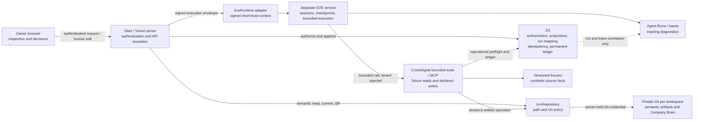

# CrossSignal state ownership

## Reconstruction rule

- Rebuild semantic meaning from private Git and canonical human reviews.
- Rebuild operational authorization/action state from D1 and the permanent
  ledger.
- Resume runtime work from EVE only after reloading current ICM and D1 state.
- Treat the UI and expiring traces as projections, never recovery authorities.
- If expected ICM heads/hashes and D1 authorization hashes disagree, show a
  reconciliation state and perform no side effect or brain merge.
