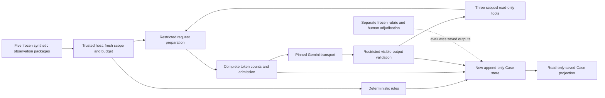

# Architecture — one bounded investigator, one durable Case

The host controls scope, credentials and admission. The model proposes a query
or finding. A restricted worker validates it; only bounded read-only evidence
can come back. Recording sits around the network boundary so failure remains
inspectable. The model has no action, identity, policy or filesystem authority.

Credentials exist only at the host transport. Public observations enter model
requests; private truth/rubric/development chat/prior answers do not. The
evaluator is a separate assessment context, not feedback to the investigator.
Provider-native search, files, code and remote MCP are disabled.

## Code paths to inspect

- [contracts.mjs](../../../../db/benchmark/contracts.mjs): exact scoped data,
  immutable evidence hashes, host bindRun and timestamp/argument validation.
  [tools.mjs](../../../../db/benchmark/tools.mjs) and schemas.mjs expose the
  same evidence universe eagerly or through revenue/engineering/support queries.
- [gemini-context.mjs](../../../../db/benchmark/gemini-context.mjs): reconstructs
  each request from public task/schema/current-run query results. It admits no
  caller-supplied conversation, previous answer or grader fields.
- [gemini-runner.mjs](../../../../db/benchmark/gemini-runner.mjs): fresh ledger,
  token count → durable lease/request → dispatch → restricted parse → counted
  tool intent/validated result → finding or retained terminal failure.
- [gemini-budget.mjs](../../../../db/benchmark/gemini-budget.mjs),
  [gemini-http.mjs](../../../../db/benchmark/gemini-http.mjs) and
  [gemini-execution.mjs](../../../../db/benchmark/gemini-execution.mjs): original
  limits, abortable streaming, exact fixed route and frozen-source/Free-tier gate.
  Source drift and the existing execution claim prevent another launch now.
- [gemini-isolation.mjs](../../../../db/benchmark/gemini-isolation.mjs) and
  worker: fresh permission-restricted Node process, exact source reads, stripped
  environment, no writes/children or model code evaluation. These controls are
  tested with actual denial probes, not just a prompt asking for confidentiality.
- [gemini-store.mjs](../../../../db/benchmark/gemini-store.mjs): workspace/Case/run
  foreign keys, FULL-synchronous atomic append, mutation triggers, evidence and
  timeline integrity, interruption handling. Unknown dispatched usage is terminal;
  a reload never recreates forgotten inference budget.
- [inspection.mjs](inspection.mjs) and [prepare.mjs](prepare.mjs): draft-only
  15-record plan and read-only projection of the two retained original records.
  They import no transport, execution, rules runner or private evaluator module.
  SQLite opens with readOnly=true; source/manifest/history equality is checked.

## Reuse and UI scope

The existing [CaseDecisionView](../../../../app/CaseDecisionView.tsx) already
presents signal metrics, support/counterevidence, expandable raw observations,
recommendation and provenance. Its runtime result shape and approval actions
are different from benchmark-finding-v1. The prepared static Case viewer reuses
that presentation, common finding/data/tool schemas and benchmark persistence;
it does not remount a writable runtime route or manufacture legacy authority.
It is a readable offline export with no JavaScript, external assets or requests.
Mounting a minimal read-only benchmark projection into the existing UI remains
an implementation step after scope review, with no broader component rewrite.

Recommendation is the initial showcase endpoint. Existing exact-approval,
one-time execution, Pause and outcome components stay intact and uninvoked.
Their fixture regressions are mechanics evidence; actual intervention authority
and observed business recovery are separate and absent here.

The 15-record route itself remains a proposal. The existing run-benchmark.mjs
still defines the accepted 35-record initial schedule; do not use it to execute
the unaccepted smaller study. No factory restart or new generic framework.
