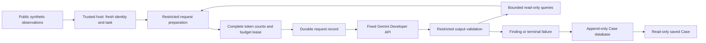

# Architecture and interview code paths

The host owns scope, credentials, admission and persistence. Gemini chooses a
bounded query or finding. A fresh restricted worker validates it. The evaluator
is separate and never feeds private truth or rubric back into investigation.

## Code to explain

- [run.mjs](run.mjs): verifies accepted/fresh upstream gates, exact scope and
  source proof; claims one immutable session; counts all ten scheduled initial
  requests; rotates method positions; opens fresh stores; stops on unknown
  usage or provider/model compatibility failure. The existing execution claim
  prevents launching the batch again. No later-stage gate is changed.
- [wire.mjs](wire.mjs), [http.mjs](http.mjs) and [transport.mjs](transport.mjs):
  small additive wire projection, exact schema/settings validation, timed
  REST transport and bounded diagnostic recording. HTTP_SOURCE_PROVENANCE
  binds the original transport and exact local validation changes. The actual
  route still rejects generation; do not claim the repair succeeded.
- [gemini-context.mjs](../../../../../../db/benchmark/gemini-context.mjs):
  reconstructs each body from synthetic public task/schema and current-run
  allowed results. No arbitrary conversation or previous-answer injection.
- [gemini-isolation.mjs](../../../../../../db/benchmark/gemini-isolation.mjs):
  fresh permission-restricted workers with stripped environment, exact source
  reads and no writes or child process. Node permissions are not a complete
  same-user OS/network sandbox. No model code is evaluated or native network,
  file or effect tool exposed; actual denial probes support this boundary.
- [gemini-budget.mjs](../../../../../../db/benchmark/gemini-budget.mjs) and
  [gemini-runner.mjs](../../../../../../db/benchmark/gemini-runner.mjs): count
  full context and reserve output including reasoning, write before dispatch,
  validate visible output in a restricted worker, count attempted tools and
  accumulate actual generation. A dispatched request with missing usage ends
  indeterminate; reload cannot invent a new budget or retry it.
- [gemini-store.mjs](../../../../../../db/benchmark/gemini-store.mjs): scoped
  foreign keys, FULL-synchronous atomic appends, mutation triggers, immutable
  observations and hash-chained timeline. Original A01/runtime databases and
  migrations are not touched.
- [review.mjs](review.mjs): reuses the original read-only inspector, validates
  exact sources/manifest/results, corrects the derived provenance to the accepted
  fresh 15-record schedule, and renders a script-free saved Case. No execution,
  credential source, writable store or private evaluator is imported.
- [preservation.mjs](preservation.mjs): the accepted additive qualification
  checks logical index content against HEAD, current raw index unchanged, every
  original file hash and only exact new source/result boundaries. The old strict
  raw-index assertion remains failed as historical evidence.

## Design decisions to defend

The three methods share frozen data/task/cutoff and host schema. Rules provide
a baseline; single-shot receives eager allowed evidence; tool-using Gemini must
retrieve it. Evidence access and compute differ intentionally, so compare their
retrieval, countersearch, latency and token records without implying a fair
fixed-compute comparison or robust accuracy from one replicate.

The static review keeps the existing Case presentation: signal, evidence,
provenance and history. It avoids changing writable product routes while the
provider happy path is unresolved. Existing approval, execution and Pause
components are preserved and uninvoked. Recommendations are not effects.

Failure analysis is a deliverable. The original failed session and this new
failure stay separate. The diagnostic candidate is pending; it cannot recover
discarded error prose or turn an unclassified error into a confirmed cause.
Private evaluator files are hashed only by the host and never enter workers or
requests. No tuning or evaluator feedback occurs on transfer Cases.

The earlier [interview guide](../../INTERVIEW_GUIDE.md) remains historical.
Use this packet's accepted scope and current result status when discussing it.
